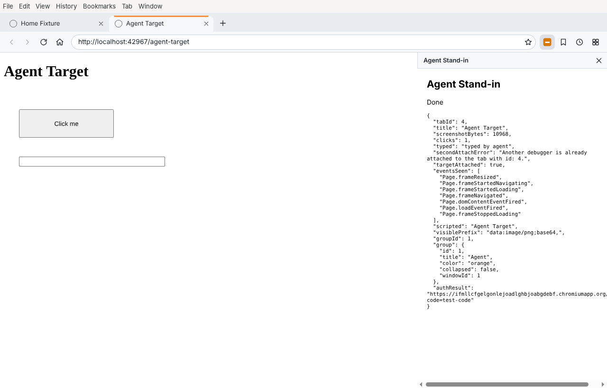

# Chrome2

A minimal desktop web browser built on Electron 45.2.1 (Chromium 156 engine) with tabs, an address bar, bookmarks, history, and Chrome extension support. It also adds compatibility shims so agent-style extensions such as **Claude in Chrome** have the side panel, debugger and tab-group APIs they rely on.



> Name note: "Chrome" is a Google trademark. Chrome2 is an independent project, not affiliated with Google; fine for personal or classroom use, but check before distributing it publicly.

## Features

| Area | What you get |
|---|---|
| Tabs | Open (`+`, Ctrl/Cmd+T), close (`×`, middle-click, Ctrl/Cmd+W), switch (click, Ctrl+Tab), drag to reorder. Links that open new windows become tabs next to their opener; real popups (e.g. OAuth) stay popups. |
| Address bar | Accepts URLs (`example.com`, `localhost:3000`, `https://…`) or search terms, which go to **Google**. Back, forward, reload/stop and home buttons. Unreachable pages show an error page that keeps the URL. |
| Robustness | Video/HTML fullscreen hides the toolbar and fills the window (Esc exits). A crashed tab shows a "This page crashed" page and Reload brings it back. A frozen page gets Chrome's "Page Unresponsive" prompt (Wait / Exit page). Error pages say what stopped a page: an extension, a policy on this computer, the network's filter or proxy, or an untrusted certificate. |
| Start-up | The window always opens: slow or broken extensions keep loading in the background instead of holding it back, and a start that failed is followed by a safe-mode start without extensions. See [If Chrome2 won't open](#if-chrome2-wont-open). |
| Bookmarks | Star button (Ctrl/Cmd+D) and a Bookmarks panel. Stored in `bookmarks.json`. |
| History | Every page visit, newest first, searchable, single delete or clear all. Stored in `history.json`. |
| Import | Copies bookmarks and history from Google Chrome, Edge, Brave, Arc, Vivaldi or Chromium. See [Import from another browser](#import-from-another-browser). |
| Extensions | **Add to Chrome** from the Chrome Web Store (with an install prompt and automatic updates), or **Load unpacked…** from a folder with `session.extensions.loadExtension`. Extensions are re-loaded on every start, with toolbar buttons, popups, side panels and content scripts. Permissions this browser can't honour are flagged in the Extensions panel. |
| Agent extension support | `chrome.debugger` (CDP), `chrome.sidePanel`, `chrome.tabGroups`, `chrome.tabs.group/captureVisibleTab`, `chrome.identity.launchWebAuthFlow`, with Chrome's "… started debugging this tab" banner and its Cancel button. |
| Site permissions | Camera, microphone, location, notifications and similar requests ask Allow/Block once per site. Electron would otherwise grant them all silently. |

## Requirements

* Node.js 22 (tested with 22.23.4) and npm 10
* Runs on Windows 10+, macOS 13 (Ventura)+ and Linux x64/arm64, matching Electron 45's support matrix

All dependency versions are pinned exactly (`.npmrc` has `save-exact=true`):

| Package | Version | Why |
|---|---|---|
| `electron` | 45.2.1 | Chromium engine and runtime |
| `electron-chrome-extensions` | 4.10.0 | `chrome.tabs`, `windows`, `action`, `contextMenus`, `cookies`, `notifications`, `webNavigation`, native messaging |
| `electron-chrome-web-store` | 0.13.0 | Installing and updating extensions from chromewebstore.google.com |
| `electron-builder` (dev) | 26.18.0 | Windows/macOS packaging |
| `playwright-core` (dev) | 1.64.1 | End-to-end tests (Electron driver, no browser downloads) |

## Setup

```bash
git clone https://github.com/AnduWii/ProjectExpertOrdinance.git
```

```bash
cd ProjectExpertOrdinance
```

```bash
npm ci
```

```bash
npm start
```

`npm start` opens the browser on the home page (Google). Pass URLs to open them as tabs: `npm start -- https://example.com`.

### Where your data lives

Everything is plain JSON in the app's user-data folder:

| OS | Folder |
|---|---|
| Windows | `%APPDATA%\Chrome2` |
| macOS | `~/Library/Application Support/Chrome2` |
| Linux | `~/.config/Chrome2` |

Upgrading from the older "Ordinance Browser" build moves its folder's contents here on first start (bookmarks, history, extensions and logins), leaving a `MOVED.txt` note behind.

* `bookmarks.json`: `{ "version": 1, "bookmarks": [{ "id", "url", "title", "createdAt" }] }`
* `history.json`: `{ "version": 1, "entries": [{ "id", "url", "title", "visitedAt" }] }`. Capped at 5,000 entries; repeat visits to the same URL are collapsed.
* `settings.json`: `homePage`, `searchUrl` (default `https://www.google.com/search?q=`; `homePage` defaults to `https://www.google.com/`), `extensions` (folders to load at start-up) and `ignoredExtensions` (drop-in folders you removed)
* `WebStoreExtensions/`: extensions installed from the Chrome Web Store
* `extensions/`: any unpacked extension folder dropped here is loaded automatically. Removing one in the Extensions panel keeps it removed after a restart.
* `logs/main.log`: warnings, errors and crashes from the browser itself (rotated at 1 MB to `main.log.old`). Send this file when reporting a problem.
* `startup-in-progress`: exists only while Chrome2 is starting. If it is still there at the next launch, that launch uses safe mode.

If a saved extension can't be loaded at start-up (for example, its folder was moved), the Extensions panel lists it with the error and a button to forget it.

Writes are atomic (temp file + rename). A corrupt file is renamed to `*.corrupt-<timestamp>`, not overwritten.

### If Chrome2 won't open

1. **It may already be running.** Only one copy runs at a time; opening it again hands over to the running one. If no window appears, quit Chrome2 in Activity Monitor (macOS) or Task Manager (Windows), then open it again.
2. **Safe mode.** If a start never got a window on screen, the next start skips extensions and shows a notice; quitting and reopening loads them again. To force it, start Chrome2 with `--safe-mode`:

   ```bash
   open -a Chrome2 --args --safe-mode
   ```

   On Windows, run `Chrome2.exe --safe-mode` from its install folder. From source: `npm start -- --safe-mode`.
3. **Read the log.** `logs/main.log` in the data folder (above) records why a start failed. If start-up itself fails, Chrome2 shows the error and exits, instead of sitting invisible in the background.
4. **macOS says Chrome2 "is damaged and can't be opened":** the app isn't broken. macOS refuses downloaded apps that aren't signed with an Apple Developer ID and notarised, and Chrome2's builds are only ad-hoc signed. For this message there is no **Open Anyway** button. Move Chrome2 to Applications, then clear the download flag once:

   ```bash
   xattr -dr com.apple.quarantine "/Applications/Chrome2.app"
   ```

   Use a build from a `main` run, or from a pull-request run made after the signing fix in CI; before that fix, pull-request builds came out unsigned. If the Mac is managed by a school or employer, its administrator may block unsigned apps entirely; that has to be allowed by them. Windows' "Windows protected your PC" is the same thing: click **More info → Run anyway**. See *Code signing* under [Build installers](#build-installers).
5. **It bounces in the Dock or nothing happens, with no message.** First, don't edit `Info.plist` or anything else inside `Chrome2.app`. The signature covers those files, and after any change macOS kills the app at launch without saying why. Delete that copy and install a fresh one from the `.dmg`, or re-sign the edited copy:

   ```bash
   codesign --force --deep --sign - "/Applications/Chrome2.app"
   ```

   Then start it from Terminal; whatever stops it is printed there:

   ```bash
   /Applications/Chrome2.app/Contents/MacOS/Chrome2
   ```

   `Killed: 9` means the signature is broken (re-sign as above). Also check `~/Library/Application Support/Chrome2/logs/main.log`: every start writes a `starting` line and a `window shown` line, and a copy that finds Chrome2 already running says so.

Extensions get 8 seconds to load before the first window opens anyway (`ORDINANCE_EXTENSION_WAIT_MS` changes this); after that they finish loading in the background.

### Keyboard shortcuts

| Action | Windows / Linux | macOS |
|---|---|---|
| New tab / close tab | Ctrl+T / Ctrl+W | ⌘T / ⌘W |
| Next / previous tab | Ctrl+Tab / Ctrl+Shift+Tab | same |
| Focus address bar | Ctrl+L | ⌘L |
| Reload | Ctrl+R, F5 | ⌘R |
| Back / forward | Alt+← / Alt+→ | ⌘[ / ⌘] |
| Home | Alt+Home | ⇧⌘H |
| Bookmark page / bookmarks panel | Ctrl+D / Ctrl+Shift+O | ⌘D / ⇧⌘O |
| History panel | Ctrl+H | ⌘Y |
| Page DevTools | Ctrl+Shift+I | ⌥⌘I |

## Import from another browser

Open the Bookmarks panel and click **Import from another browser…** (or use **Bookmarks → Import From Another Browser…** in the menu bar). Chrome2 looks for Google Chrome (including Beta, Dev and Canary), Microsoft Edge, Brave, Arc, Vivaldi and Chromium, lists their profiles, and copies the profile you pick. Anything Chrome2 already has is skipped, so it's safe to run again.

* **What it copies:** bookmarks and up to 5,000 recent history entries. It never copies passwords, cookies or logins. Those are encrypted with a key in the OS keychain, and pulling live sessions out of another browser is what cookie-stealing malware does. Sign in inside Chrome2 instead.
* **If it can't find or read your browser,** the dialog lists every folder it checked and what happened (not found, blocked by the system, or no profiles). Click **Choose Folder…** and pick the browser's data folder. For Chrome on macOS that's `~/Library/Application Support/Google/Chrome`, and the picker opens nearby. You can pick `Chrome`, the `Default` profile inside it, or `Google` above it.
* **macOS privacy controls** can stop one app from reading another app's data. If the picked folder is also "blocked by the system", go to System Settings → Privacy & Security → Full Disk Access, turn on Chrome2, then quit and reopen it.

## Extensions

**From the Chrome Web Store:**

1. Click the **grid icon** in the toolbar, then **Chrome Web Store** (or just browse to chromewebstore.google.com).
2. Open an extension and click **Add to Chrome**. The button keeps Chrome's wording; it installs into Chrome2.
3. Confirm the **Add "…"?** prompt. It lists what the extension can do and anything Chrome2 can't support.

Store extensions keep their Chrome extension ID and update automatically every 5 hours. **Remove** in the Extensions panel uninstalls them completely.

**From a folder (unpacked):**

1. Click the **grid icon** in the toolbar, then **Load unpacked…**.
2. Pick the folder that contains `manifest.json`.

Either way, the extension's button appears in the toolbar. Click it to open its popup or its side panel, or to fire `chrome.action.onClicked`.

The browser loads extensions with `session.extensions.loadExtension`. Electron 36 deprecated `session.loadExtension` and moved it to `session.extensions`; the code falls back to the old call on older Electron. Electron does not remember extensions between runs, so the browser saves the folder path in `settings.json` and re-loads it on start.

Local `.crx` files cannot be opened directly. Install from the store, or unzip the extension and load it unpacked.

### Manifest V3 APIs Electron does not support

Measured, not copied from docs. A probe extension requesting every MV3 permission ran in bare Electron 45.2.1 and inside this browser; see [docs/extension-api-support.md](docs/extension-api-support.md) for the full tables and raw JSON.

**Missing from Electron 45 itself.** Bare `session.extensions.loadExtension` gives no namespace for any of these:
`accessibilityFeatures`, `bookmarks`, `browsingData`, `commands`, `contentSettings`, `contextMenus`, `cookies`, `debugger`, `declarativeContent`, `desktopCapture`, `downloads`, `fontSettings`, `gcm`, `history`, `identity`, `instanceID`, `notifications`, `omnibox`, `pageCapture`, `privacy`, `processes`, `readingList`, `search`, `sessions`, `sidePanel`, `tabCapture`, `tabGroups`, `topSites`, `tts`, `ttsEngine`, `userScripts`, `webAuthenticationProxy`, `webNavigation`, `windows`.
Electron's `chrome.tabs` lacks `create`, `remove`, `group`, `ungroup` and `captureVisibleTab`. `chrome.system.display` exists but every call fails. `chrome.storage.managed` is unsupported.

**What this browser adds back:**

* `electron-chrome-extensions`: `contextMenus`, `cookies`, `notifications`, `webNavigation`, `windows`, the rest of `chrome.tabs`, `action` popups/onClicked, and `runtime.connectNative`
* Its own shims: `debugger`, `sidePanel`, `tabGroups`, `identity` (`launchWebAuthFlow`, `getRedirectURL`), `tabs.group/ungroup/captureVisibleTab`, and correct `tabs`/`index` lists on `chrome.windows` objects

**Still unsupported here:** `accessibilityFeatures`, `bookmarks`, `browsingData`, `contentSettings`, `declarativeContent`, `desktopCapture`, `fontSettings`, `gcm`, `history`, `instanceID`, `omnibox`, `pageCapture`, `processes`, `readingList`, `search`, `sessions`, `tabCapture`, `tts`, `ttsEngine`, `userScripts`, `webAuthenticationProxy`.
`downloads`, `privacy`, `topSites` and `commands` exist only as no-op stubs from electron-chrome-extensions, so extension keyboard shortcuts never fire. `system.display` always errors.

Working in bare Electron 45, though its docs don't list them: `alarms` (fires), `offscreen`, `declarativeNetRequest` dynamic rules, `idle`, `system.cpu`, `system.memory`, `storage.session`.

## Claude in Chrome

**Status, measured on 2026-11-04 by the live CI job ([`test/e2e/09-claude-online.test.js`](test/e2e/09-claude-online.test.js)):**

| Step | Result |
|---|---|
| Open Claude's page on the real Chrome Web Store | Works, though the store still shows its "Switch to Chrome" banner (cosmetic; see below) |
| Click **Add to Chrome** | Chrome2's prompt appears, then Claude installs in about 1 second with its real ID `fcoeoabgfenejglbffodgkkbkcdhcgfn` |
| Click Claude's toolbar icon | Its side panel opens ("Claude for Chrome") on the **Log in** screen |
| Extension errors / console errors / failed shim calls | None |
| `chrome.*` APIs referenced in Claude's code | All present in Chrome2 except `downloads` (no-op stub) and `commands` (keyboard shortcuts never fire) |
| Logged-in use (agent actions on pages) | **Not verified**: it needs a paid Claude account, which CI doesn't have |

Claude uses these APIs most: `tabs` (233 references), `runtime` (218), `storage` (136), `tabGroups` (67), `windows` (36), `alarms` (31), `scripting`, `declarativeNetRequest`, `debugger`, `action`, `webNavigation`, `notifications`, `sidePanel`, `offscreen`, `permissions` and `identity`. Every one exists in Chrome2. `debugger`, `sidePanel`, `tabGroups` and `identity` come from this repo's shims, which the stand-in extension test ([`test/e2e/05-agent-extension.test.js`](test/e2e/05-agent-extension.test.js)) drives end to end: CDP clicks and typing, screenshots, tab groups and the web-auth flow.

Anthropic supports Claude in Chrome on Google Chrome; in Chrome2 it is unsupported and an extension update can change what it needs.

**Install it:**

1. Click the **grid icon**, then **Chrome Web Store**, and search for **Claude**. Or go straight to https://chromewebstore.google.com/detail/claude/fcoeoabgfenejglbffodgkkbkcdhcgfn
2. Ignore the blue "Switch to Chrome" banner. Click **Add to Chrome**, then **Add extension**.
3. Click the orange Claude icon in the toolbar. The side panel opens; click **Log in**.
4. Sign in to claude.ai in the tab that opens. Use **Continue with email** if Google sign-in refuses: Google often blocks sign-in from browsers it doesn't recognise ("This browser or app may not be secure").

Known gaps that may matter for it:

* **Claude Code / Claude Desktop integration** uses native messaging. electron-chrome-extensions looks for host manifests in Chrome's locations (`NativeMessagingHosts` folders on macOS/Linux, the HKCU/HKLM `Software\Google\Chrome\NativeMessagingHosts` registry keys on Windows) and in `<user data>/NativeMessagingHosts`. Store installs keep Claude's Chrome ID, so hosts that allow it should answer. Untested.
* Claude's download features (`chrome.downloads`) and keyboard shortcuts (`chrome.commands`) won't work.
* Per-tab side panels: the panel is per window.

**Fixed: "Failed to query tabs: Cannot read properties of undefined (reading 'id')".** Claude's browser session (`tabs_context_mcp` with `createIfEmpty`) failed with this error. The cause was `chrome.windows.create`, `get` and `getAll`, which returned every window with `tabs: []`. That came from electron-chrome-extensions 4.10.0, the latest release, so code expecting Chrome's behaviour broke on `win.tabs[0].id`. `src/main/window-details.js` now lists each window's tabs in tab-strip order with their real `index`, like Chrome. Tab groups were never affected.

### Check the window and tab-group APIs yourself

`test/fixtures/extensions/window-probe` is a small test extension. Its service worker calls `windows.getAll`, `windows.create({url:'about:blank'})`, `tabs.query`, `tabs.group`, `tabGroups.update/query/get` and `windows.get`, the way agent extensions do, and shows each result. `test/e2e/12-windows-api.test.js` runs it on every CI build.

**In Chrome2:**
1. Click the **grid icon**, then **Load unpacked…**, and pick the `window-probe` folder.
2. Open the Extensions panel and copy the **Window Probe** ID, the 32 letters after "Unpacked ·".
3. Type `chrome-extension://<that ID>/probe.html` in the address bar and press Enter.
4. A second window opens and closes. The page then lists every call with its result.

**In Google Chrome, to compare:** open `chrome://extensions`, turn on **Developer mode**, click **Load unpacked**, pick the same folder, then open `chrome-extension://<its ID>/probe.html`.

What a working browser shows: `windows.create(...)` has `"tabCount": 1` and a numeric `firstTabId`, and the next line, `createdWindow.tabs[0].id`, is that same number. `tabs.group` returns a group ID, and `tabGroups.query` lists the group. If `createdWindow.tabs[0].id` shows `Cannot read properties of undefined (reading 'id')`, that build has the old bug.

Prefer not to use the store? Loading a copy of the installed folder from a Chrome profile also works:
`~/Library/Application Support/Google/Chrome/Default/Extensions/<id>/<version>_0` on macOS, `%LOCALAPPDATA%\Google\Chrome\User Data\Default\Extensions\<id>\<version>_0` on Windows. Use **Load unpacked…** on it.

## Build installers

```bash
npm run dist:win
```

```bash
npm run dist:mac
```

Outputs land in `dist/`:

| Command | Produces |
|---|---|
| `npm run dist:win` | `Chrome2-<ver>-win-x64.exe` and `-win-arm64.exe` (NSIS installers), a combined `-win.exe`, and `.zip` portable builds |
| `npm run dist:mac` | `-mac-x64.dmg`, `-mac-arm64.dmg` and matching `.zip` files, **ad-hoc signed** |
| `npm run dist:mac:signed` | Same, signed with the Developer ID certificate in your keychain or `CSC_LINK`, hardened runtime on. Notarisation is not configured. |
| `npm run dist:linux` | x64 AppImage |
| `npm run pack` | Unpacked app for the current OS (quick smoke test) |

Notes:

* **Build on the target OS.** DMGs need macOS (`hdiutil`, `sips`). From Linux, electron-builder can make macOS `.zip` files but cannot sign them, and Apple-silicon Macs refuse unsigned modified apps. Windows installers can be built on Linux or macOS only with Wine (64- and 32-bit) installed; the `.zip` targets need nothing extra.
* **Code signing.** Without certificates the Windows installer triggers SmartScreen and the ad-hoc-signed Mac app triggers Gatekeeper on other machines. On macOS 15+ open it once, then use **System Settings → Privacy & Security → Open Anyway** (right-click → Open no longer bypasses Gatekeeper), or run `xattr -dr com.apple.quarantine "/Applications/Chrome2.app"`. electron-builder 26 does not ad-hoc sign by itself, which is why `dist:mac` passes `-c.mac.identity=-`.
* **CI.** [`.github/workflows/ci.yml`](.github/workflows/ci.yml) runs unit and end-to-end tests on Ubuntu, then builds natively on `windows-2025` and `macos-15` and uploads the installers as workflow artifacts. Actions are pinned to commit SHAs.

## Tests

```bash
npm test
```

```bash
npm run test:e2e
```

* `npm test`: unit tests for URL/search parsing, the JSON stores, the extension support table, the start-up helpers and the error-page messages (Node's built-in test runner)
* `npm run test:e2e`: launches the real app with Playwright's Electron driver and exercises tabs, navigation, extensions, bookmarks/history, the agent stand-in, site permissions, fullscreen, crash recovery, extension load errors, start-up safety (slow extensions, safe mode) and Web Store installs (against a stand-in store page). `ORDINANCE_ONLINE=1` also runs `09-claude-online`, which installs the real Claude in Chrome from the live Web Store. Set `ORDINANCE_APP_PATH=/path/to/packaged/binary` to test a packaged build instead of `electron .`.

On Linux the e2e suite needs a display (`xvfb-run -a npm run test:e2e` on a headless box) and **must not run as root**. Chromium refuses to run as root unless given `--no-sandbox`, and Electron skips service-worker preloads without the sandbox, which breaks every MV3 extension API this browser adds. On Ubuntu 24.04 you may also need `sudo sysctl -w kernel.apparmor_restrict_unprivileged_userns=0`. The harness launches with `chromiumSandbox: true` for the same reason; Playwright otherwise adds `--no-sandbox` on Linux.

## Known limitations

* **Extensions:** see the unsupported API list above. Web Store downloads are checked against the store's HTTPS connection and the extension ID, but the CRX signature itself is not verified. They use Node's `fetch`, which ignores system proxy settings, so installs fail behind a corporate proxy. Extensions are not available in private/in-memory sessions (an Electron restriction), so there is no incognito mode. Per electron-chrome-extensions, MV2 background pages are always persistent. If the app's own `session.webRequest` is used, `chrome.webRequest` listeners stop firing.
* **Address bar:** no suggestions or autocomplete. Host detection is heuristic: `node.js` is treated as a domain because there is no public-suffix list.
* **Browser features not built:** downloads manager UI (Electron shows a plain save dialog), password manager, autofill, sync, reader mode, multiple profiles, session restore, tab pinning, tab drag between windows, and a visible collapse/title UI for tab groups (only the colour shows).
* **Import:** Chromium-based browsers only (no Safari or Firefox). Bookmark folders are flattened into one list, and passwords, cookies and logins are never copied.
* **Site permissions** are remembered only until restart, with no settings page to review them.
* **Security model:** tabs run sandboxed with context isolation and no Node.js. The toolbar UI talks to the main process over a fixed IPC allow-list. Extension shims check the calling extension's manifest permissions in the main process. Electron's Chromium is patched on Electron's release schedule, not Chrome's, so keep `electron` current.
* **Sites that sniff the browser:** the user agent drops the `Electron/` token so sites see a normal Chrome UA, but `navigator.userAgentData.brands` and the `Sec-CH-UA` headers still differ from Google Chrome. That's why the Chrome Web Store keeps showing "Switch to Chrome" even though installing works. Changing those headers would need `session.webRequest`, which would stop other extensions' `chrome.webRequest` listeners, so it isn't done.

## Project layout

```
src/main/main.js            app start-up, IPC, menu, extension wiring
src/main/window.js          one window: tab views, side panel, layout
src/main/url.js             address-bar input -> URL or Google search
src/main/profile.js         moves the old "Ordinance Browser" profile to Chrome2
src/main/startup.js         start-up safety net: log file, extension time limit, safe mode
src/main/window-details.js  chrome.windows: list each window's tabs like Chrome does
src/main/store.js           bookmarks/history/settings JSON files
src/main/extensions.js      load/remove/persist extensions (unpacked and Web Store)
src/main/extension-support.js  measured API support table
src/main/compat/index.js    debugger, sidePanel, tabGroups, identity (main side)
src/main/permissions.js     site permission prompts
src/preload/ui-preload.js   toolbar UI bridge
src/preload/compat-preload.js  extension API shims (extension contexts only)
src/renderer/               toolbar UI (HTML/CSS/JS)
test/unit, test/e2e         tests; test/fixtures/extensions holds test extensions
```

## License

MIT. See [LICENSE](LICENSE).
